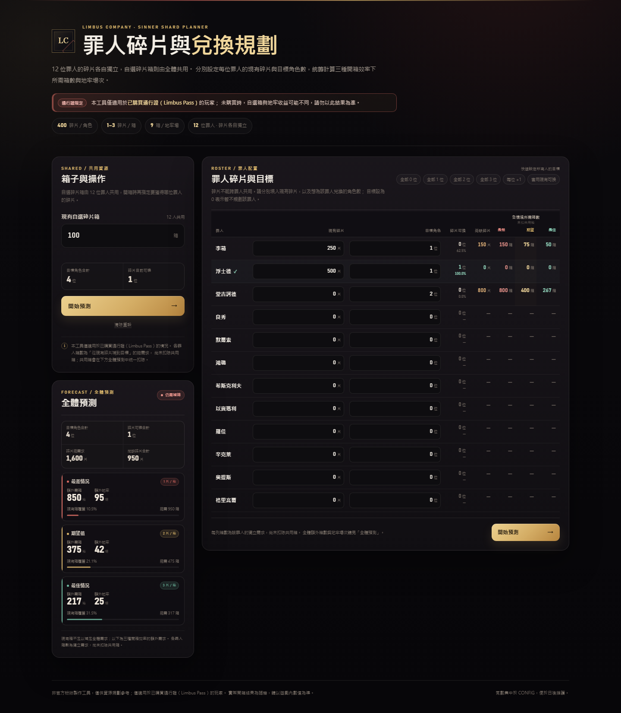

# 邊獄公司｜罪人碎片與兌換規劃

以 12 位罪人的獨立角色碎片與共用自選碎片箱為核心的兌換規劃工具。單一 HTML 檔案、零外部依賴，可直接開啟或部署到 GitHub Pages。

> [!IMPORTANT]
> **通行證限定。** 本工具僅適用於已購買通行證（Limbus Pass）的玩家。未購買通行證時，自選碎片箱與地牢收益可能不同，請勿以本工具結果為準。

> [!NOTE]
> 非官方粉絲製作工具，與 Project Moon 無關。所有計算都在瀏覽器本機完成，不會上傳任何資料。



## 功能

- 依固定順序規劃 12 位罪人：李箱、浮士德、堂吉訶德、良秀、默爾索、鴻璐、希斯克利夫、以實瑪利、羅佳、辛克萊、奧提斯、格里高爾。
- 每位罪人可分別設定「現有碎片」與「目標角色數」；目標設為 `0` 表示暫不規劃該罪人。
- 碎片各自獨立，不能跨罪人合併；自選碎片箱則由 12 人共用。
- 同時顯示最差（1 片／箱）、期望值（2 片／箱）、最佳（3 片／箱）三種情境。
- 每位罪人列出：目前碎片可換角色數、碎片進度、尚缺碎片、三種情境下所需箱數。
- 全體彙總列出：碎片總需求、尚缺碎片、全體總需箱數、扣除現有箱後的額外箱數、地牢場次。
- 支援快速設定：全部 0／1／2／3 位、每位 +1、套用現有可換。
- 輸入驗證：空值、負數、小數、文字與全體目標為 0 都有繁中提示。
- 桌機、平板、手機皆可使用；窄螢幕會將表格轉為罪人卡片。

## 使用方式

1. 直接用瀏覽器開啟 [`index.html`](index.html)，或使用 GitHub Pages 網址。
2. 在「現有自選碎片箱」填入 12 位罪人共用的箱子總數。
3. 為每位罪人填入現有碎片，以及想兌換的角色數。
4. 按「開始預測」。
5. 查看：
   - 各罪人卡片／表格列的三種情境所需箱數。
   - 「全體預測」中的額外箱數與地牢場次。

### 表格數值怎麼看

- **各情境所需箱數**：該罪人從現有碎片補到目標的**總需求**，尚未扣除共用箱。
- **全體額外需箱**：把 12 位罪人的需求相加後，扣掉現有共用箱的結果。共用箱只扣一次。
- **地牢場次**：以每場 9 箱計算，不足 1 場無條件進位。
- 若現有碎片已達到該罪人的目標，該列所需箱數為 `0`。

## 計算規則

### 每位罪人獨立計算

```text
目標碎片 = 目標角色數 × 400
尚缺碎片 = max(0, 目標碎片 − 現有碎片)
所需箱數 = ceil(尚缺碎片 ÷ 每箱片數)
```

- 碎片不能跨罪人轉移，因此每位罪人必須各自無條件進位，不能先把 12 人的碎片加總後再除。
- 目前碎片可換角色數 = `floor(現有碎片 ÷ 400)`。
- 碎片進度 = `min(100, 現有碎片 ÷ 目標碎片 × 100%)`。

### 共用箱與全體需求

```text
全體總需求箱數 = Σ（12 位罪人的所需箱數）
額外箱數 = max(0, 全體總需求箱數 − 現有共用箱)
地牢場次 = ceil(額外箱數 ÷ 9)
```

### 三種情境

| 情境 | 每箱碎片 | 說明 |
| --- | ---: | --- |
| 最差 | 1 片 | 悲觀估計，所有箱子都開到最低值 |
| 期望值 | 2 片 | 以 1–3 片的平均期望值計算 |
| 最佳 | 3 片 | 樂觀估計，所有箱子都開到最高值 |

> 本工具採固定 1／2／3 片進行情境試算，不進行隨機模擬。實際開箱結果仍可能與預測不同。

## 常見問題

### 為什麼各罪人箱數相加，和全體額外箱數不同？

因為「各罪人箱數」是未扣共用箱的總需求；「全體額外箱數」才是扣除現有箱後的缺口。例如三位罪人合計需要 950 箱，目前有 100 箱，額外需求就是 850 箱。

### 為什麼最佳情況不是把總碎片需求直接除以 3？

因為碎片不能跨罪人合併。以 12 位罪人都需要 400 片、每箱 3 片為例，每人需要 `ceil(400 ÷ 3) = 134` 箱，全體是 `12 × 134 = 1,608` 箱，而不是 `4,800 ÷ 3 = 1,600` 箱。

### 需要購買通行證嗎？

需要。本工具僅適用於已購買通行證（Limbus Pass）的情況；未購買通行證時，自選碎片箱與地牢收益可能不同，計算結果不適用。

### 資料會上傳嗎？

不會。所有輸入與計算都只在瀏覽器本機進行，沒有後端、帳號、Cookie 或分析追蹤。

## 部署到 GitHub Pages

1. 將這個資料夾推送到 GitHub 倉庫。
2. 進入倉庫的 **Settings → Pages**。
3. 在 **Build and deployment** 選擇 **Deploy from a branch**。
4. Branch 選擇 `main`（或你的預設分支），資料夾選擇 `/ (root)`。
5. 儲存後等待 GitHub Pages 建置，即可透過 Pages 網址開啟。

`.nojekyll` 已包含在專案中，避免 GitHub Pages 對靜態檔案做不必要的 Jekyll 處理。本專案不需要建置步驟，也不需要安裝 npm 套件。

### 本機開啟

直接雙擊 `index.html` 即可。若瀏覽器對本機檔案有額外限制，也可以在專案資料夾執行：

```bash
python -m http.server 8000
```

再開啟 `http://localhost:8000/`。

## 自訂常數

遊戲數值集中在 `index.html` 的 `CONFIG` 物件中，搜尋 `const CONFIG` 即可找到：

```js
const CONFIG = Object.freeze({
  SHARDS_PER_CHARACTER: 400,
  BOXES_PER_DUNGEON: 9,
  MAX_INPUT: 1_000_000_000_000,
  DEFAULT_TARGET: 1,
  // ...
});
```

- `SHARDS_PER_CHARACTER`：每個角色需要的碎片數。
- `BOXES_PER_DUNGEON`：每場地牢可獲得的自選碎片箱數。
- `DEFAULT_TARGET`：重新載入或重設後，每位罪人的預設目標角色數。

罪人名稱與順序位於同一個檔案中的 `SINNERS` 陣列。修改後請重新整理頁面。

## 專案結構

```text
.
├── index.html      # 完整計算機（HTML / CSS / JavaScript）
├── preview.png     # README 與介面預覽圖
├── README.md       # 本文件
├── LICENSE         # MIT 授權
├── .gitignore      # 忽略作業系統與編輯器暫存檔
└── .nojekyll       # GitHub Pages：停用 Jekyll
```

## 驗證

已針對 1440、1181、1180、1024、821、820、720、390、320px 寬度檢查版面，桌面與手機皆無橫向溢位。核心計算涵蓋：

- 單一罪人碎片足夠／不足。
- 12 位罪人獨立取整。
- 共用箱扣除與多餘箱數。
- 三種開箱效率與地牢無條件進位。
- 空白、負數、小數、文字與全體目標為 0。

## 授權

本專案採用 [MIT License](LICENSE)。遊戲名稱、角色名稱與相關商標皆屬原權利人所有；本專案未包含遊戲圖像或素材。

本專案由作者構思並在 DeepSeek 輔助下開發完成。
